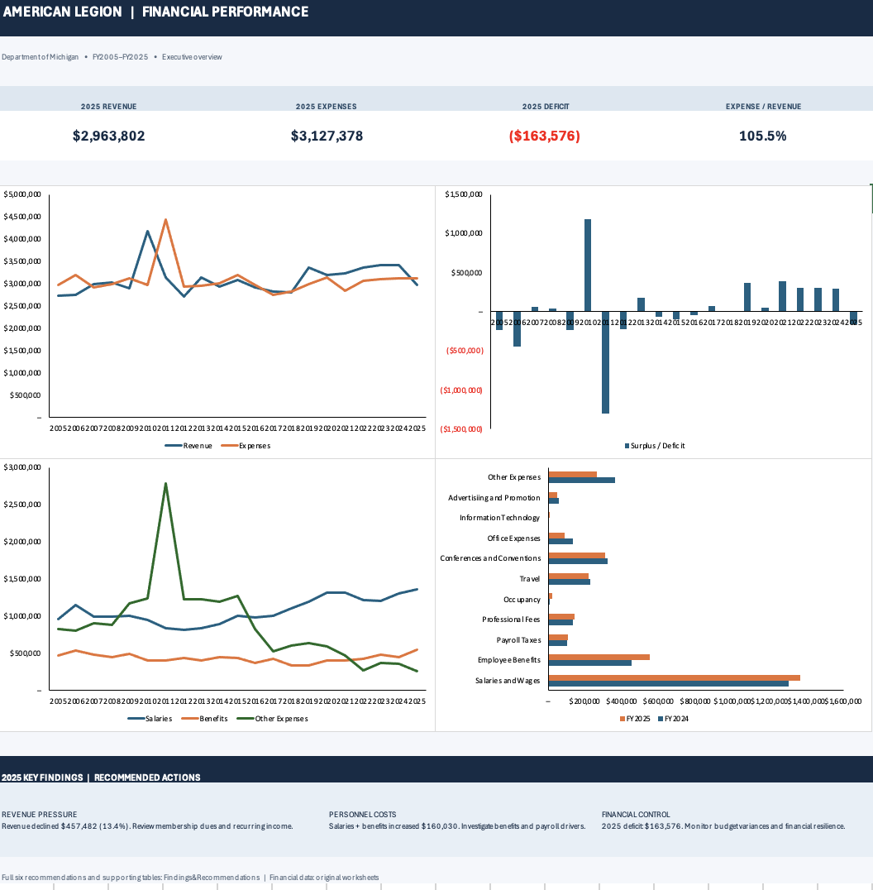

# American Legion Department of Michigan — Financial Performance Analysis (2005–2025)

**Tools:** Microsoft Excel · Financial statement analysis · Variance analysis · Dashboarding · Data validation

## Project overview

Analyzed 21 fiscal years (2005–2025) of American Legion Department of Michigan financial data derived from IRS Form 990 filings. Built an Excel workbook with annual financial statements, revenue and expense breakdowns, balance-sheet metrics, financial performance ratios, an executive-style dashboard, six prioritized recommendations, and reconciliation checks.

**Objective:** Explain changes in financial performance, identify important revenue and expense drivers, and support focused budgeting and financial monitoring.

> This is a historical financial analysis and portfolio project, not an audit. Recommendations are proposed actions, not verified implemented savings. Passing arithmetic reconciliations does not independently verify source entries.

## Executive findings: FY2024 vs. FY2025

| Metric | FY2024 | FY2025 | Change |
|---|---:|---:|---:|
| Total revenue | $3,421,284 | $2,963,802 | **−$457,482 (−13.37%)** |
| Total expenses | $3,121,896 | $3,127,378 | **+$5,482 (+0.18%)** |
| Operating surplus / (deficit) | +$299,388 | −$163,576 | **−$462,964** |
| Salaries and wages | $1,304,509 | $1,366,359 | **+$61,850** |
| Employee benefits | $452,366 | $550,546 | **+$98,180** |
| Membership dues | $1,221,899 | $1,062,668 | **−$159,231** |
| Contributions and grants | $1,284,390 | $1,396,957 | **+$112,567** |

**Key takeaway:** The $462,964 deterioration was driven overwhelmingly by falling revenue ($457,482, approximately 98.8% of the net change), while expenses increased only $5,482. Salaries and employee benefits rose by a combined **$160,030**, offset by decreases in other expense categories. Membership dues fell while contributions and grants rose.

## Dashboard

Explore the `Executive Dashboard` worksheet for the landscape summary, and `Findings&Recommendations` for the detailed findings in the [Excel workbook](American_Legion_Financial_Analysis_Complete_Dashboard.xlsx) for the full dashboard, trend charts, variance analysis, and recommended actions.

## Analysis approach

1. Compile annual financial statement data from FY2005–FY2025.
2. Categorize revenues and expenses, including membership dues, contributions, payroll, benefits, and other categories.
3. Calculate annual surpluses/deficits, growth rates, ratios, and balance-sheet indicators.
4. Investigate FY2024–FY2025 category-level variances.
5. Reconcile category totals and check `assets = liabilities + net assets`; flag source entries for manual review.
6. Translate material findings into recommendations and monitoring measures.

## Six prioritized recommendations

| Priority | Area | Recommended action | Suggested measure |
|---|---|---|---|
| High | Employee benefits and payroll | Investigate benefit increases by plan, enrollment, premiums, and one-time adjustments. | Benefits as % of expenses; YoY growth |
| High | Revenue stability | Investigate declining membership dues and other revenue; review renewal rates and nonrecurring revenue. | Membership dues growth; recurring revenue share |
| High | Deficit monitoring | Establish monthly budget-versus-actual reviews. | Operating surplus/deficit; expense/revenue ratio |
| Medium | Other expense transparency | Itemize residual “Other Expenses” before treating changes as repeatable savings. | Itemized costs; repeatable savings |
| Medium | Office and event spending | Review sustainability of lower office expenses and event costs relative to participation. | Office costs; event cost per attendee |
| Medium | Financial resilience | Monitor net assets, cash, and liabilities to assess capacity to absorb future deficits. | Net assets; cash-to-liabilities ratio |

These recommendations are proposed investigations and monitoring actions, **not verified realized savings**.

## Workbook guide

| Worksheet | Contents |
|---|---|
| `Annual Financial Summary` | FY2005–FY2025 annual financial metrics |
| `Revenue Breakdown` | Revenue categories and annual totals |
| `Expense Breakdown` | Expense categories and annual totals |
| `Balance Sheet` | Assets, liabilities, and net assets |
| `Financial Analysis` | Growth rates, ratios, and financial indicators |
| `Findings&Recommendations` | Dashboard, findings, and six recommendations |
| `Data Quality Checks` | Reconciliation checks and source-review notes |

## Data sources and limitations

- **Source:** Public IRS Form 990 filings for American Legion Department of Michigan, FY2005–FY2025. Specific filing URLs have not been independently verified for this publication.
- **Missing data:** Some historical cells contain `NULL`, meaning category detail is unavailable, not necessarily zero.
- **Validation:** The workbook's `Data Quality Checks` worksheet reports `PASS` for annual arithmetic checks but flags historical entries for source review.
- **Comparability:** Reporting and category definitions may differ over time. Residual “Other” categories require careful interpretation.
- **Scope:** No audited opinion, implemented recommendations, or realized cost savings are claimed.

## Skills demonstrated

Financial statement analysis · Excel modeling · Financial variance analysis · Cost-driver investigation · Revenue trend analysis · Data reconciliation · Dashboard design · Business reporting · Actionable recommendations

**Portfolio note:** This project demonstrates the workflow from public financial statements to a decision-oriented dashboard and prioritized recommendations.
